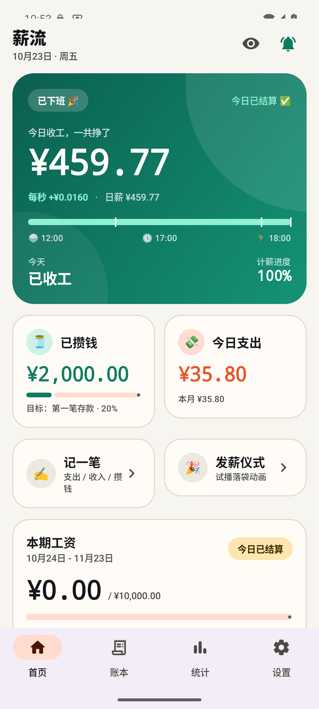
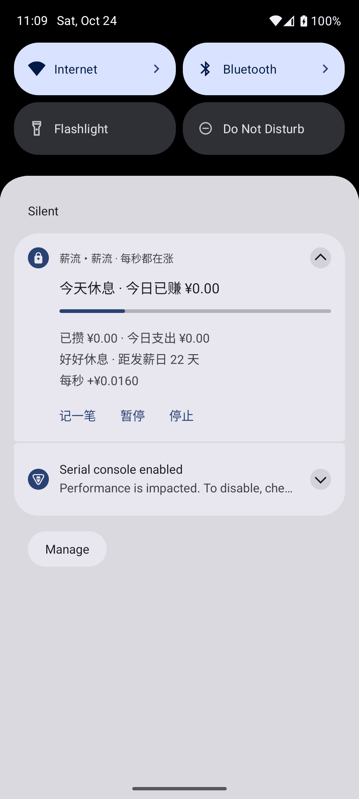
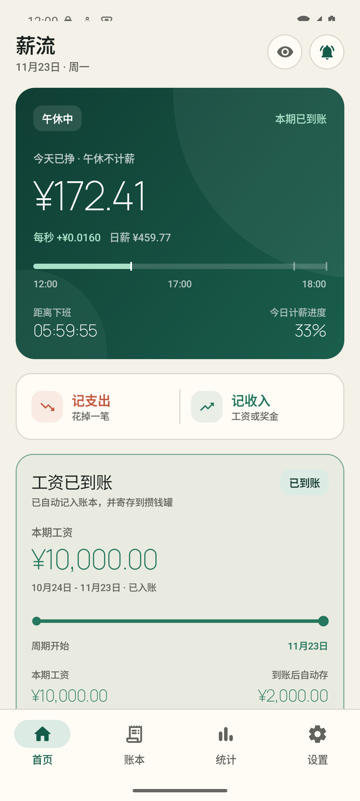
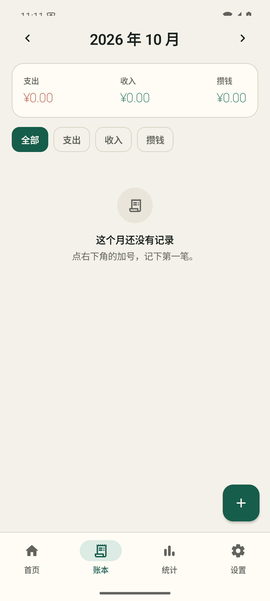
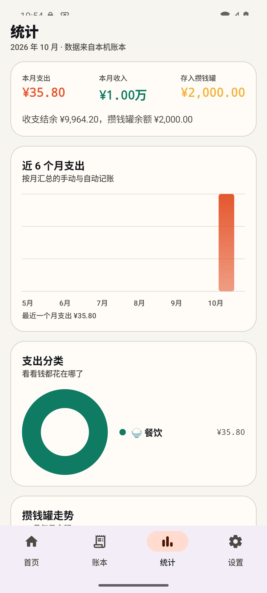

# 薪流 SalaryFlow

把工资的累积过程放进通知栏：单行查看今日已挣，随手记账，发薪日自动完成到账。



## 下载安装

前往 [GitHub Releases](https://github.com/shirou10086/salaryflow/releases/latest) 下载已签名的
[`SalaryFlow-v0.2.0.apk`](https://github.com/shirou10086/salaryflow/releases/latest/download/SalaryFlow-v0.2.0.apk)。

- 最低支持 Android 8.0（API 26）；
- 首次安装时，系统可能要求允许当前浏览器或文件管理器安装未知应用；
- APK 使用独立发布证书签名，SHA-256 校验值附在对应 Release 中。

## 首次设置

首次打开在一屏内完成：

- 输入税后月薪与每月发薪日；
- 自定义上班、下班时间；
- 输入当前存款，也可以先留空；
- 完成设置后开启工资通知。

计薪天数、工作日、午休和提醒方式可在设置中继续调整。

## 功能

自动跟随系统语言，支持中文和英文；Android 13 及以上还可以在系统的“应用语言”中单独切换。

可在“设置 → 关于 → 语言”直接打开语言设置。Android 13 及以上可只修改薪流的语言，
Android 12 及以下会跟随系统语言。

### 工资通知



- 通知栏以单行持续显示今日已挣；
- 可直接执行“记支出”和“记收入”；
- 支持隐藏金额、刷新频率和开机恢复设置；
- 默认每秒刷新，也可调整为 5 秒、10 秒或 1 分钟。

### 发薪日到账


- 结算周期为上月发薪日次日到本月发薪日；
- 发薪日按完整月薪记入工资收入，并同步增加总存款；
- 服务、后台任务和打开应用都会触发结算，同一周期只入账一次；
- 到账时播放动画，工资卡切换为已到账状态。



### 记账与统计



- 首页提供独立的 `− 记支出`、`+ 记收入`；
- 支持分类、备注、按天浏览和删除；
- 自动记账与手动记账统一展示。



- 本月支出、收入与结余；
- 近 6 个月支出柱状图；
- 本月支出分类环形图；
- 每日存款余额走势。

### 存款

- 首次设置时可填写当前存款；
- 后续收入增加、支出减少，存款自动更新；
- 金额有变化时可在首页或设置中随时更新；
- 每月可收到一次存款更新提醒。

### 桌面小组件

2×2 小组件显示今日收入、总存款与服务状态。

### 应用更新

- 默认每天在应用启动时自动检查 GitHub 正式版本；
- 发现新版本后可显示更新说明、下载进度并交给系统完成安装；
- 安装前会校验 APK 包名、版本和签名，保留现有账本数据；
- Android 出于安全限制，首次更新需要在系统页面允许薪流安装应用。

## 计算规则

| 指标 | 公式 |
| --- | --- |
| 日薪 | `月薪 ÷ 每月计薪天数`（默认 21.75 天） |
| 每秒工资 | `日薪 ÷ 每个工作日的计薪秒数` |
| 今日收入 | `今天从上班到现在的计薪秒数 × 每秒工资` |
| 计薪秒数 | `(下班时间 - 上班时间) - 不计薪的午休` |
| 发薪日入账 | `完整月薪` |

午休是否计薪、工作日、计薪天数和发薪日均可在设置中修改。当前版本未内置法定节假日与调休日历。

## 构建

环境要求：JDK 17、Android SDK（`compileSdk 35`、Build Tools 35.0.0）。

```bash
echo "sdk.dir=$HOME/Library/Android/sdk" > local.properties
./gradlew :app:testDebugUnitTest :app:lintDebug :app:assembleDebug :app:assembleRelease
```

产物：

```text
app/build/outputs/apk/debug/app-debug.apk
app/build/outputs/apk/release/app-release-unsigned.apk
```

安装 Debug 包：

```bash
adb install -r app/build/outputs/apk/debug/app-debug.apk
```

发布版需要在仓库外使用自己的密钥签名，仓库不包含签名文件或密码。

## 技术栈

- Kotlin + Jetpack Compose（Material 3）
- Room 流水账本 + DataStore 设置
- Foreground Service + NotificationCompat
- WorkManager 发薪日结算与存款提醒
- AppWidgetProvider 桌面小组件
- JUnit 覆盖金额、计薪、发薪周期与结算规则

```text
app/src/main/java/com/salaryflow/app/
├── core/        薪资时钟、金额与时间格式
├── data/        Room、DataStore、发薪日结算
├── service/     前台通知、开机恢复、结算通知
├── work/        WorkManager 调度
├── widget/      桌面小组件
└── ui/          Compose 页面、主题和到账动画
```

欢迎提交 Issue / PR。

## License

[MIT](LICENSE)
